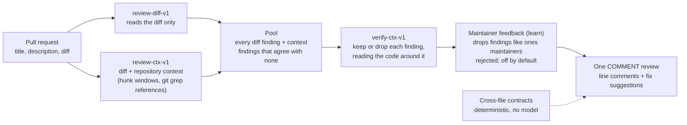

# TraceHound

An open-source GitHub Action that reviews pull requests with NVIDIA Nemotron on Nebius Token Factory.

## Try it

Add a repository secret `NEBIUS_API_KEY` (your Token Factory key), then save this as
`.github/workflows/tracehound-review.yml`:

```yaml
name: TraceHound review

on:
  pull_request:
    types: [opened, synchronize, reopened, ready_for_review, closed]

permissions: {}

jobs:
  review:
    if: github.event_name == 'pull_request' && github.event.action != 'closed' && github.event.pull_request.head.repo.full_name == github.repository
    runs-on: ubuntu-latest
    timeout-minutes: 20
    permissions:
      contents: read
      pull-requests: write
    concurrency:
      group: tracehound-review-${{ github.event.pull_request.number }}
      cancel-in-progress: true
    steps:
      - uses: actions/checkout@v4
        with:
          ref: ${{ github.event.pull_request.head.sha }}
          persist-credentials: false
      # 0aeef06… is the commit tagged review-freeze-2, the frozen release that was measured.
      # The model runs every review stage (both reviewers and the verifier) on Nemotron 3.5
      # Super VL; fixes run on Nemotron 3 Super.
      - uses: SunnyBagal/TraceHound/.github/actions/tracehound-review@0aeef06fa8742cc8a36581c3894e554b8748c965 # review-freeze-2
        with:
          nebius-api-key: ${{ secrets.NEBIUS_API_KEY }}
          model: 'nvidia/Nemotron-3.5-Super-VL'
```

This is the review job of [the example workflow](docs/action/example-workflow.yml) without its
graph-history job. Pull requests from forks are skipped, because forks don't get repository
secrets. Inputs, permissions and limits are in [docs/action/README.md](docs/action/README.md).

## How it works



- **Two generators** run in parallel on Nemotron: one sees only the diff, the other also sees
  the changed files and the places that reference the changed names.
- **Pool, then verifier:** the verifier sees each pooled finding with the code around it and keeps
  or drops it. This three-stage pipeline is `pool-verify-v1` (decision 059).
- **Cross-file contracts** (on by default; [docs/contracts.md](docs/contracts.md)): a
  deterministic check that a renamed export, route, queue, Redis, env or event key still matches
  the files the PR did not edit. It makes no model calls; network only for a credential-free git
  fetch of the base commit.
- **Learning from maintainer feedback:** `learn: 'on'` suppresses findings similar to comments
  maintainers rejected, and records each suppression in the review footer. It is off by default
  and the benchmark does not measure it ([docs/learn.md](docs/learn.md)).

Stages we tried and dropped, each a loss on the dev set:
[064, vote across runs](docs/decisions.md#064--vote-across-runs-dev-only-a-loss) and
[065, evidence verifier + gate](docs/decisions.md#065--evidence-verifier--deterministic-gate-dev-only-a-loss).
Every lever we tried is in the [levers table](docs/bench/results.md#6-precision-levers-tried-on-dev).

## Results

Every result below is the product: **pool-verify-v1 on Nemotron 3.5 Super
(`nvidia/Nemotron-3.5-Super-VL`) at tag `review-freeze-2` (`0aeef06`)**, via Nebius Token Factory,
called TraceHound v2 here. Benchmark: `ai-code-review-evaluations/golden_comments` (5 repos × 10
PRs). F is scored by bench-judge-v1 (the scorer of record) with bench-judge-x1 as a second judge.
The tools' rows are their recorded reviews in the public dataset, scored with our judges; we did not
run the tools.

### Blind test: Cal.com (10 PRs, n = 23 golden comments)

Pre-registered before the run; chosen on dev before this look; no tuning after; one run
([v2-calcom.md](docs/bench/v2-calcom.md), decision 069).

| reviewer | P | R | F (judge v1, scorer of record) | F (judge x1) |
|---|---|---|---|---|
| **TraceHound v2 (pool-verify-v1, 3.5)** | 63.2% (12/19) | 52.2% (12/23) | **57.1%** | 58.5% |
| TraceHound v1 (3 Super, 062, run 1) | 56.0% | 60.9% | 58.3% | 58.3% |
| Augment | 83.3% | 65.2% | 73.2% | 73.2% |
| Cursor | 81.3% | 56.5% | 66.7% | 66.7% |
| Greptile | 58.8% | 43.5% | 50.0% | 55.0% |
| Copilot | 35.7% | 65.2% | 46.2% | 50.8% |
| CodeRabbit | 34.6% | 39.1% | 36.7% | 37.5% |

On 10 blind Cal.com PRs, TraceHound is statistically tied with four of five commercial reviewers
(Augment, Cursor, Greptile, Copilot) and ahead of one (CodeRabbit; only 10 PRs).

**v2 is the product config, and this is the second blind look at Cal.com.** The first look was v1
(pool-verify-v1 on Nemotron 3 Super, tag `review-freeze-1`, decision 062). v2's model and pipeline
were chosen on our 40-PR dev set before this run, the plan was pre-registered and pushed before the
first 3.5 call on Cal.com, nothing was tuned after it, and there is no second v2 run. The v1 row is
kept beside it, unchanged, so the two looks can be read together.

### All 50 PRs (dev 40 + Cal.com 10, n = 97)

| reviewer | F v1 | F x1 |
|---|---|---|
| Augment | 66.3% | 65.9% |
| Cursor | 53.8% | 58.8% |
| **TraceHound v2** (dev 7r + Cal.com 4) | **52.2%** | **55.4%** |
| Greptile | 49.5% | 55.1% |
| CodeRabbit | 40.0% | 45.0% |
| Copilot | 35.2% | 42.0% |

Across all 50 PRs: behind the leading reviewer (Augment), statistically tied with the next two
(Cursor, Greptile), ahead of the last two (CodeRabbit, Copilot) (3rd of 6 as a point estimate). Both
judges agree (069b paired bootstrap, 10,000 resamples, seed 69;
[v2-intervals.md](docs/bench/v2-intervals.md)). Against v1 (3 Super), v2 is ahead under
bench-judge-v1 (+11.0 [+1.8, +20.1]) and statistically tied under bench-judge-x1. 40 of these 50 PRs
are our dev set, which the configuration was tuned on.

### ReviewBench test runs

ReviewBench test runs (25 PRs, one round, ReviewBench's own judge); not a leaderboard submission.
Image `9b9a5127`, pre-registered in P008 ([reviewbench.md](docs/bench/reviewbench.md)).

| # | config | grounded F1 | G P | G R | augmented F1 | A P | findings |
|---|---|---|---|---|---|---|---|
| 331 | **pool-raw-x2 · 3 Super** (pre-registered winner) | **21.3** | 76.3 | 12.4 | 30.6 | 50.6 | 222 |
| 333 | pool-raw-missed · 3 Super | 20.4 | 64.5 | 12.1 | 28.9 | 43.9 | 194 |
| 328 | pool-raw · 3 Super | 16.0 | 70.6 | 9.0 | 23.0 | 52.5 | 124 |
| 330 | pool-verify-v1 · 3 Super | 13.9 | 79.5 | 7.6 | 22.3 | 67.2 | 99 |
| 329 | pool-raw · 3.5 | 13.5 | 56.3 | 7.7 | 19.0 | 44.0 | 86 |
| 332 | pool-verify-v1 · 3.5 (= the product) | 12.2 | 69.2 | 6.7 | 17.6 | 57.2 | 60 |

- **No final run, no leaderboard entry.** The final (219 PRs × 3 rounds) would cost about $107 with
  VAT, measured from #331 ($3.45 per 25-PR round), against a $43.52 balance (P008 amendment 8).
- Six configs on the same 25 PRs: the best of them is subject to selection bias.
- **3.5 won on our dev set but lost on ReviewBench**, in both pipelines (pool-verify-v1 12.2 vs 13.9;
  pool-raw 13.5 vs 16.0). ReviewBench's grounded metric rewards volume (findings), which the
  product's verifier cuts.

### Seeded pull requests on the live config

[[TBD-SEEDED]]

The rule: every number links to its run record; every loss is published. Full results, losses and
limits: [docs/bench/results.md](docs/bench/results.md).

## Losses

- The component graph did not help the repair agent (decision 050).
- Context-aware verifier (058), vote across runs (064), evidence verifier (065), recall-v3 (070:
  both arms below P009's precision floor) and Nemotron 3 Ultra (071): each a loss.
- v3 was measured partly hampered (truncation, a per-PR cap); 2 v3 defects found by Bugbot are
  documented, not fixed.
- No ReviewBench final run (money; see above).

Nemotron 3 Ultra (report only, free NVIDIA API, not Token Factory, not the product): the 550B
Nemotron 3 Ultra did not review better than 3.5 Super on our pipeline. Over dev runs 10 and 11
(judge v1), its pool-verify-v1 mean F was 47.1, against 3.5's 50.4 and 3 Super's 42.3, with no
interval-backed difference. Its pool-raw mean F was 43.6 against 3.5's 53.9 (−10.2 [−17.7, −3.2]),
the only interval that excludes 0. Under judge x1: pool-verify-v1 54.9, pool-raw 51.4
([docs/bench/dev-ultra.md](docs/bench/dev-ultra.md)).

## Cost per pull request

- About $0.06–0.07 per PR on 3.5 (pre-VAT; dev median $0.063, mean $0.074), about 2 minutes wall
  time per PR (median on dev). 3.5 fails to return valid JSON on about 7 of 40 PRs per dev run, and
  the review is then partial (a chunk lost).
- Whole-project Nebius spend (30 days to 24 Oct): $57.05 + VAT.

## Live demo

[`SunnyBagal/tracehound-demo`](https://github.com/SunnyBagal/tracehound-demo) runs the Action pinned
to `@0aeef06` with the 3.5 model set explicitly. On demo PR #2, the current config posted no
findings (24 Oct). The older reviews posted there came from earlier generators on Nemotron Nano and
are not the current config. Seeded PRs on the current config: [[TBD-SEEDED]].

## Built with

- **NVIDIA Nemotron 3.5 Super** (`nvidia/Nemotron-3.5-Super-VL`) via Nebius Token Factory, the
  product model (decision 068) for both reviewers and the verifier. Decision 067 adopted it on 2
  dev runs: v1 F 50.4 vs 42.3; the second judge's interval includes 0. Decision 068 made it the
  Action's default, with partial reviews when a chunk fails.
- **NVIDIA Nemotron 3 Super** (`nvidia/nemotron-3-super-120b-a12b`) via Nebius Token Factory, for
  the fix suggestions, which were not measured on 3.5. Prices:
  [config/prices.json](config/prices.json) (third-party rates, not yet checked in the Nebius
  console).
- TypeScript on Node 24, ts-morph and GitHub Actions. Pooling, the contract check and learning
  use no model.

## What's next

- Recover chunks lost to invalid JSON (JSON repair or schema-constrained output; a retry with
  reasoning off mostly failed in 070).
- A per-PR comment cap, against product noise: replayed on saved dev runs ($0,
  [docs/bench/levers-v2.md](docs/bench/levers-v2.md)), no cap on the shipped, verified pipeline
  improves F with an interval excluding 0; small gains appear only on the unverified pool at
  k = 4–5. A hypothesis, not adopted.
- The verifier: on dev, verified scores above raw with an interval excluding 0 in 2 of 9 runs
  (3 Super 2r, Ultra 11); on 3.5 neither run shows a difference (−1.6 and −5.4, intervals include
  0); on ReviewBench raw scores higher in both models. An open question, not a finding
  ([levers v2](docs/bench/levers-v2.md)).
- A cheaper 2-of-3 vote across runs: no gain established (levers v2).
- Where the misses are: both 3.5 dev runs miss 35 of 74 Medium+ golden comments; none of the 7
  Critical ones is missed by both; the most missed repo is sentry (14 of 21 Medium+).
- Cheaper experiments: run-to-run spread exceeds most effects, so replay on saved records before
  paying for runs.
- Measure what maintainer-feedback learning changes in posted reviews.

---

## Details

TraceHound maps TypeScript codebases into evidence-backed component graphs: every edge on the
canvas points back to a file, symbol and line range in the analyzed code, with the extractor that
found it and how confidently the value was resolved (`proven` · `resolved-default` · `dynamic`).

It also has a repair loop on open NVIDIA Nemotron models whose fixes are verified independently
of the agent in a sandbox, and a reproduce stage that writes one failing test for a bug claim
and checks it in a fresh sandbox, independently of the agent. **The graph did not help the repair agent.** In a pre-registered
held-out evaluation (8 seeded tasks on one repo, 160 runs), the agent resolved about as many
tasks with the graph as without it, and never called a graph tool. See
[Held-out evaluation](#held-out-evaluation).

- **Analyzer** (`packages/analyzer`) — ts-morph + Zod. Deterministic extraction of imports,
  routes, Redis and Prisma usage and env reads. It groups files into responsibility-based
  components and writes a snapshot keyed by commit SHA + analyzer version. There's an optional
  naming pass with NVIDIA Nemotron (Nebius Token Factory) that works from extracted facts only,
  under hard budget caps.
- **Viewer** (`viewer/`) — static Next.js + React Flow + ELK canvas with node and edge
  inspectors, evidence snippets, GitHub permalinks and a warnings panel.

## PR reviewer benchmark

This section is the first look, v1 (pool-verify-v1 on Nemotron 3 Super, `review-freeze-1`,
decisions 062 and 066). The product config's numbers are under [Results](#results).

On 10 blind pull requests (Cal.com run 1, n = 23), TraceHound is statistically tied with Greptile and Cursor. Its run-1 F was 58.3% against CodeRabbit's 36.7%, but that is not a significant lead. No gap to another tool is outside its 95% interval. The CodeRabbit gap is the clearest: TraceHound is ahead in 96% of resamples, but its interval still includes 0 ([audit-cc01 §3.2](docs/bench/audit-cc01.md#32-bootstrap-95-ci-over-prs-for-the-calcom-f-difference)). Across all 50 pull requests it is 4th of 6 under both judges ([all-50 table](docs/bench/results.md#5-all-50-prs)). Every loss is published, including every precision lever we tried on dev ([levers table](docs/bench/results.md#6-precision-levers-tried-on-dev)); the run-to-run spread at temperature 0 is larger than every effect we tried to measure. Tool numbers come from their recorded reviews in the public benchmark dataset, scored with our judge; we did not run the tools. F under bench-judge-v1; details, losses and limits in [docs/bench/results.md](docs/bench/results.md).

| reviewer | F, blind (Cal.com run 1, n = 23) | F, dev (run 1, n = 74) |
|---|---|---|
| Augment | 73.2% | 64.1% |
| Cursor | 66.7% | 49.6% |
| **TraceHound** (pool-verify-v1) | 58.3% | 35.6% |
| Greptile | 50.0% | 49.3% |
| Copilot | 46.2% | 31.3% |
| CodeRabbit | 36.7% | 41.0% |

## Prerequisites
- Node.js ≥ 24 (the TypeScript runs on Node's native type stripping) and pnpm 11
  (`corepack enable` picks up the version pinned in `package.json`)
- git
- Docker (Docker Desktop on macOS), running, for the repair harness and its tests. Without it
  those tests are skipped with a message; everything else works.

## Quick start

```bash
pnpm install
pnpm fixture                            # clone the pinned demo repo into fixtures/demo-repo (tests use it)
pnpm test                               # analyzer + viewer tests (never call a model)
pnpm --filter @tracehound/viewer dev    # http://localhost:3000, serving the committed snapshots/
```

`pnpm demo` (= `pnpm fixture` + analyze) re-analyzes the demo repo and **overwrites the
committed snapshot in `snapshots/`**. Without `NEBIUS_API_KEY` it writes heuristic names there,
and the viewer tests, which expect the committed model-written names, then fail;
`git checkout snapshots/` restores them.

The optional Nemotron naming pass: put `NEBIUS_API_KEY=...` in `.env` (see `.env.example`).
Spend is capped by `TRACEHOUND_BUDGET_RUN_USD` (default $1) and `TRACEHOUND_BUDGET_TOTAL_USD`
(default $45). `pnpm spend` prints the ledger. Re-runs on an unchanged commit hit the response
cache and cost $0.

## Repair harness (toy task)

```bash
node eval/fixtures/build-toy-repo.ts    # build the toy repo the toy tasks point at (once)
pnpm tracehound repair --task eval/tasks/toy-discount/task.json --agent noop --provider docker
pnpm tracehound repair --task eval/tasks/toy-discount/task.json --agent nemotron --graph off --provider docker
```

- Docker must be running. The first run builds the sandbox image
  `tracehound-sandbox:bun1.4.2-ts5.9.3-2` from `harness/sandbox.Dockerfile`, which needs
  network once.
- `--agent noop` makes no model calls and ends UNRESOLVED (the bug isn't fixed). It checks the
  setup.
- `--agent nemotron` needs `NEBIUS_API_KEY`; `pnpm tracehound` loads the workspace `.env` itself.
  It runs agent-v6 (decision 047; prompt `harness/prompts/agent-v5.md`) on Nemotron Nano with reasoning on (`--reasoning off` to disable); `--graph on`
  puts a context packet from the graph in the first message and offers the graph tools. In the
  held-out evaluation this did not improve repair (below).
- Each run writes `runs/<runId>.json` with the state, the diff, every command, tokens and cost,
  and the sandbox it ran in (image id, Docker version, provider version, graph snapshot or
  `none`).

## Sandbox

- **What runs where:** Nemotron runs on Nebius Token Factory; the agent loop runs on your
  machine and calls it over the API. The agent's tools (file reads and edits, shell commands)
  and all verification (repro test, regression tests, typecheck) run in a local Docker
  container, one per run.
- **Why not Token Factory Sandboxes:** Nebius support (case AISTUDIOSUP-1966) replied that
  Sandboxes are not yet ready to be used on this account, so local Docker is the sandbox of
  record (decision 036). A Sandboxes provider can be added later behind the same interface.
- **Isolation, as tested** (`packages/analyzer/test/harness-docker.test.ts`, run in CI):
  - the network is disconnected after setup and proven off before the agent starts; requests
    from inside the agent phase fail (DNS name and raw IP)
  - the container runs as uid 1000, not root, with all capabilities dropped and
    `no-new-privileges`; only `/work` and `/scratch` are writable
  - limits: 2 GB memory, 2 CPUs, 512 processes
  - nothing from the host is mounted (no host paths, no Docker socket); the repo goes in as a
    git bundle of committed history, so untracked files like `.env` never enter; no host
    environment variables are passed
  - the container is removed after every run, and removes itself at a deadline if the harness
    dies without cleaning up
  - the base images are pinned by digest; each run records the built image's id
- **What Docker does not guarantee here:** containers share the host kernel (no VM boundary of
  their own; on macOS they run inside Docker Desktop's VM); there's no custom seccomp/AppArmor
  profile beyond Docker's defaults, no read-only root filesystem and no disk quota; network
  isolation is Docker's bridge disconnect, checked on every run, not a firewall.

## Deploy the viewer (Vercel, static export)

The viewer is a fully static export: HTML, JS and `snapshots/*.json`. No server, API or env
vars are needed at runtime.

**Option A: Git integration (recommended)**
1. On vercel.com: **Add New… → Project**, then import `SunnyBagal/TraceHound`.
2. Set **Root Directory** to `viewer`. Vercel detects Next.js and the pnpm workspace from the
   root `pnpm-lock.yaml`.
3. Build settings come from `viewer/vercel.json`: framework Next.js, build command
   `pnpm run build`, which copies `../snapshots` into `public/`, builds, and verifies the export.
   **Leave Output Directory unset.** Vercel's Next.js builder reads `.next/` and serves the
   static export itself. Pointing it at `out/` fails with "routes-manifest.json couldn't be
   found". Files outside the Root Directory must be included in the build (the Vercel default),
   because the build reads `../snapshots` and `../packages/analyzer`.
4. **Deploy.** Every push to `main` redeploys. To publish a new snapshot, commit it under
   `snapshots/` and push.

**Option B: CLI, prebuilt**
```bash
pnpm --filter @tracehound/viewer build           # → viewer/out/
npx vercel deploy viewer/out --prod              # first run: `npx vercel login`
```

To serve it under a sub-path, build with `NEXT_PUBLIC_BASE_PATH=/tracehound`.

## Held-out evaluation

Pre-registered in [`docs/eval/protocol.md`](docs/eval/protocol.md) (with Amendment 1) before any
held-out run; code frozen at tag `eval-freeze-2`. 8 seeded bug tasks on one repo (Recall), graph
on and off, Nemotron Nano and Super, 5 repeats each: 160 runs. Full tables, validity checks and
disclosures: [`docs/eval/heldout-results.md`](docs/eval/heldout-results.md).

| Model | Resolved, graph on | Resolved, graph off | Verified at stop, on | Verified at stop, off |
|---|---|---|---|---|
| Nano | 11 of 40 | 13 of 40 | 11 of 40 | 19 of 40 |
| Super | 28 of 40 | 26 of 40 | 30 of 40 | 31 of 40 |

- No difference in resolve rate between arms, as predicted in advance. No significance test was
  run; these results are not pooled with dev runs.
- The agent never called a graph tool in 80 graph-on runs, so the graph arm amounts to a context
  packet in the first message. It reached the fault file at about the same step in both arms.
- On Nano, fewer graph-on runs ended with a passing patch (11 against 19), a secondary measure.
- The model mattered far more than the graph: Super resolved 54 of 80, Nano 24 of 80.

## Known limits
- BullMQ queue pairing works when queues are constructed with literal names in plain variables.
  On ten repos it had never seen, the macro-average pairing rate was 2.1% (4 of 179 producers),
  with no wrongly named queues and one false edge. Most real code reaches queues through getters,
  wrapper functions, enum members or runtime-built names. See
  [study S1](docs/studies/s1-unseen-repos.md).

## Docs
- `CLAUDE.md` — stack, product rule, spending rules, roadmap
- `docs/decisions.md` — every non-obvious choice and the alternative we rejected
- `FEEDBACK.md` — dated observations on Nebius Token Factory + Nemotron

## Credits
- Canvas: [React Flow](https://reactflow.dev) (`@xyflow/react`, MIT). The in-canvas attribution is
  hidden (`proOptions.hideAttribution`), so it is credited here.
- Layout: [ELK](https://eclipse.dev/elk/) via [elkjs](https://github.com/kieler/elkjs) (EPL-2.0).
- Technology icons: [svgl.app](https://svgl.app), vendored in `viewer/public/icons/` (sources in
  `viewer/public/icons/CREDITS.md`).

## License
MIT
